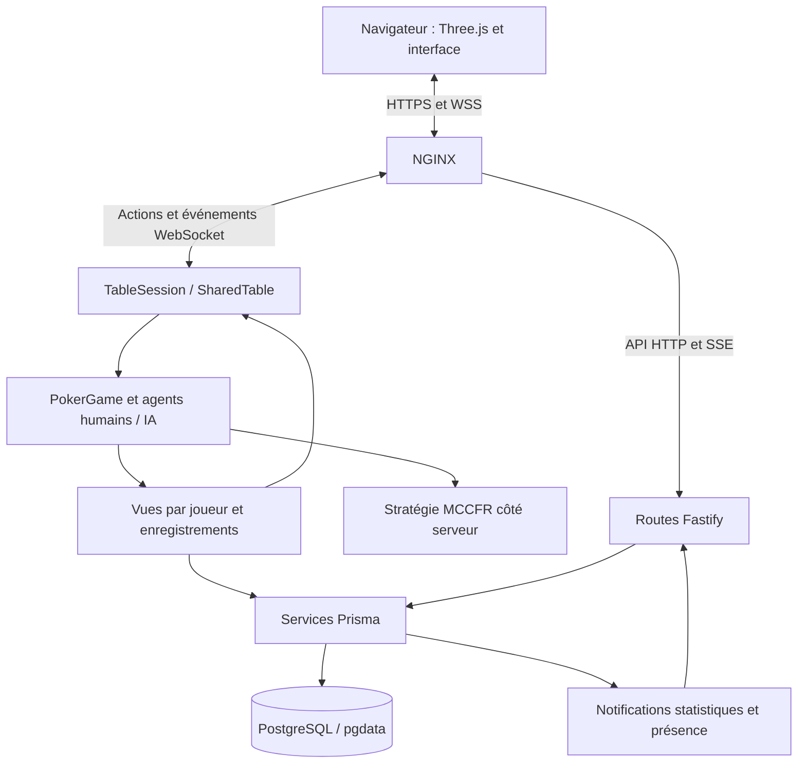

*Developed as part of the École 42 Paris curriculum.*

# ft_transcendence

**A 3D Texas Hold'em poker application: real-time multiplayer, server-side game logic, MCCFR opponents and interactive hand analysis.**

[English](#english) | [Français](#francais)


---

<a id="english"></a>
## English

[Project Context](#en-context) · [Overview](#en-overview) · [Features](#en-features) · [Engineering Highlights](#en-engineering) · [Architecture](#en-architecture) · [Getting Started](#en-start) · [Usage Examples](#en-examples)

<a id="en-context"></a>
### 1. Project Context

ft_transcendence belongs to the École 42 Paris common core curriculum, a project-based, peer-learning programme. This collective project brings together full-stack web development, API design, relational data modelling, user management, network communication and interactive gameplay, with security and deployment considered across the application.

This implementation takes the form of a **No-Limit Texas Hold'em game**. The challenge is to integrate a 3D browser interface, an authoritative backend, remote players and persistent game records into one application. This public repository presents a nearly completed version of the project and may receive further synchronized updates.

<a id="en-overview"></a>
### 2. Overview

Poker Transcendence seats the player at a 3D saloon table with animated cards, chips and a cowboy dealer. It supports play against **one to four AI opponents** and shared online tables with **two to five seats**, including at least two humans. Players create a table, join by code or invitation, then play through successive hands with persistent stacks.

The engineering challenge is coordinating **server-owned game state**, **private real-time player views** and **3D presentation**. Vanilla JavaScript, Three.js and Vite handle the frontend; Node.js, Fastify, Prisma and PostgreSQL provide the backend and persistence. WebSockets carry game actions and events; SSE updates statistics and social features. Podman Compose runs the application behind NGINX over HTTPS.

<a id="en-features"></a>
### 3. Features

| Area | Implemented scope |
|---|---|
| 3D presentation | Toon-styled saloon, animated dealer and opponents, card dealing, chip movements, seated camera and close-ups |
| Poker & opponents | No-Limit betting, all-ins, main/side pots, split pots, hand evaluation; one to four MCCFR-driven bots; configurable stacks and blinds |
| Online tables | Two to five seats including optional bots, host-controlled waiting room, six-character codes, friend invitations and temporary network reconnection |
| Accounts & friends | Email/password registration, cookie sessions, guest play, `username#tag` friend codes, requests and live presence |
| Game records | Per-player history down to individual actions, VPIP/PFR, results, 12 achievements and public leaderboard |
| Dashboard | Chart.js graphs, period/opponent filters, results in big blinds, SSE refresh, CSV and jsPDF exports |
| Range tools | 169-hand explorer, mixed-action range builder, account saves, local drafts, played-range history and solver comparison |
| Deployment | Three Compose services, HTTPS/WSS reverse proxy, healthchecks, Prisma migrations and persistent PostgreSQL volume |

AI level labels are available in the menu, but currently use the same policy (`USE_LEVELS = false`). Online tables are joined by code or invitation rather than public matchmaking.

<a id="en-engineering"></a>
### 4. Engineering Highlights

#### Keeping poker rules independent of rendering

`PokerGame` owns the deck, stacks, button and betting rounds without depending on the DOM or Three.js. Each seat supplies an `agent.decide(request)` implementation: human agents await a validated network action, while bots return a decision. Contribution levels build the main and side pots; eligible hands share tied pots, with odd chips assigned in seat order after the button.

The browser's `RemoteGame` adapter queues incoming events, and `TableController` turns them into card, chip and character animations. The server advances the rules independently of visual delays. Shared betting helpers give the action bar and server the same raise bounds: `raise.to` means the total committed on the street, not an increment.

Sources: [game engine](src/shared/poker/PokerGame.js), [betting rules](src/shared/poker/betting.js), [pot distribution](src/shared/poker/showdown.js), [remote adapter](src/front/net/RemoteGame.js), [animation controller](src/front/game/TableController.js).

#### Synchronizing private views without duplicating the game

`SharedTable` runs **one game for every participant**, but rotates events so each browser sees its player at seat 0. `viewEvent()` also removes opponents' hole cards from the deal. The unfiltered rotated events feed each player's recorder, reusing the same history and statistics pipeline without changing the frontend's seat convention.

Each private channel has sequenced messages, a reconnect token and a bounded 2,048-message history. Reconnection replays missing messages or supplies the current hand's state. Actions must match the pending `requestId` and pass server-side legality checks. The 30-second turn clock begins on `actionShown`, after preceding animations; expiry plays fold/check automatically. Solo pause freezes the clock, while shared tables continue for the other players. Live tables remain in memory rather than surviving a backend restart.

Sources: [shared tables](server/src/table/shared.js), [view transformations](src/shared/poker/viewpoint.js), [private channels](server/src/table/channel.js), [registry](server/src/table/registry.js), [turn handling](server/src/table/session.js), [protocol](server/src/table/PROTOCOL.md).

#### Mapping real decisions to a compact solver strategy

The bot converts cards into strength buckets and betting actions into the offline solver's heads-up abstraction. `describeInfoset()` produces a **64-bit key**, represented with `BigInt`; `StrategyTable` finds it by binary search in a packed table of sorted keys and byte-sized probabilities. Selected bet sizes are translated back to the real table and clamped to legal amounts. Missing or off-tree situations use a strength/pot-odds fallback.

The same infoset pipeline classifies recorded player decisions for comparison with the strategy. An abstraction fingerprint versions those derived counters. The C++ trainer lives outside this repository; the supplied strategy binary is loaded on the server, not sent to browsers during normal play. Multiway decisions are translated into the heads-up abstraction, not presented as a separately solved multiway strategy.

Sources: [bot decisions](src/shared/ai/PokerBot.js), [infoset construction](src/shared/ai/mccfr/infoset.js), [history translation](src/shared/ai/mccfr/historyTranslator.js), [binary lookup](src/shared/ai/mccfr/StrategyTable.js), [server loader](server/src/ai/solverData.js), [player counters](server/src/stats/infosets.js).

#### Separating account identity from browser sessions

Passwords are hashed with **Argon2id**, a random salt and an optional environment-supplied pepper. A login creates a random 32-byte token in an `HttpOnly`, `SameSite=Strict` cookie, marked `Secure` in production. Only its SHA-256 digest and expiry are stored in PostgreSQL; logout revokes the session by deleting its row.

Fastify schemas validate HTTP inputs and restrict authentication response fields. `requireUser` protects personal routes, and services scope records to their owner. Login attempts are rate-limited. WebSocket entry independently checks origin, message size and rate before turn validation; NGINX preserves the public host and port so origin checks match the browser's address.

Sources: [password hashing](server/src/auth/password.js), [session lifecycle](server/src/auth/sessions.js), [authentication routes](server/src/auth/routes.js), [schemas](server/src/auth/schemas.js), [route guard](server/src/auth/guard.js), [WebSocket transport](server/src/table/routes.js).

#### Deriving live statistics from recorded hands

The relational chain **`User → Game → Hand → Action`** preserves each hand and its ordered moves. `saveServerHand()` inserts those records and advances the game's stacks/hand count in one transaction, conditioned on the previous state to detect duplicate writes. Dedicated `hero…` columns support aggregation while per-seat JSON keeps the detailed history. The retained local/debug HTTP path validates submitted logs by replaying them with the same engine.

Dashboard queries share one filtered hand set and normalize results by big blind. SSE publishes account-specific `hand` notifications so charts refresh without polling. The same one-way transport supports friend presence and invitations; game decisions stay on WebSockets. Achievements and versioned infoset counters derive from recorded play, and counters can be rebuilt from the original hands.

Sources: [database schema](server/prisma/schema.prisma), [transactional recording](server/src/games/service.js), [hand replay](src/shared/stats/replay.js), [dashboard queries](server/src/stats/dashboard.js), [SSE feed](server/src/stats/liveFeed.js), [presence](server/src/friends/presence.js).

<a id="en-architecture"></a>
### 5. Architecture

The application separates **presentation (`src/front/`), reusable rules (`src/shared/`) and server services (`server/`)**. Fastify hosts both HTTP APIs and WebSocket tables in one process. NGINX serves the compiled frontend and proxies both transports; PostgreSQL stores accounts, sessions, game records, friendships, invitations and saved ranges.


Compose starts `db`, then `server`, then `nginx`, using database/backend healthchecks. The server image applies migrations before Fastify starts; the frontend uses a multi-stage Vite/NGINX build. Only NGINX publishes ports in the main stack, on host loopback. The `pgdata` volume outlives container replacement; the development override additionally exposes database/backend ports locally.

```text
src/front/           Three.js scene, camera, input, menus and network adapters
src/shared/poker/    Game engine, betting, evaluation, pots and player viewpoints
src/shared/ai/       MCCFR abstraction, strategy reader and bot decisions
src/shared/stats/    Hand recording, replay, achievements and decision analysis
src/shared/theory/   Educational preflop model and equity calculations
server/src/          Fastify APIs, sessions, tables, statistics and social services
server/prisma/       PostgreSQL schema and versioned migrations
server/data/         Server-side strategy binary
public/              Models, textures, equity and abstraction data
nginx/               Frontend Dockerfile and HTTPS reverse proxy
tests/, server/tests/ Shared-logic and backend integration tests
```

Sources: [Compose](docker-compose.yml), [development override](docker-compose.dev.yml), [server image](server/Dockerfile), [frontend image](nginx/Dockerfile), [NGINX configuration](nginx/default.conf). Further reading: [frontend](src/front/README.md), [shared logic](src/shared/README.md), [backend](server/README.md), [statistics](server/STATS.md), [roadmap](docs/project/ROADMAP.md). Module `MAN.md` files are gathered into the [manual](docs/man/index.html) by `npm run docs:man`.

Asset credits: RevK card faces (CC0), Quaternius dealer/weapons (CC0), Pieter Ferreira table (CC BY 4.0, modified), Rye/Lilita One/Nunito fonts (SIL OFL). See the [room](src/front/scene/room/MAN.md) and [card](src/front/scene/cards/MAN.md) documentation for attribution details.

<a id="en-start"></a>
### 6. Getting Started

**Requirements:** Make, Podman with a Compose provider, OpenSSL supporting `req -addext`, and a WebGL-capable browser. For host-side development, use Node.js 22 and npm. On macOS, start an initialized Podman machine with `podman machine start`; Podman runs natively on Linux.

Create `.env` at the repository root (`.env.example` is not included in this public copy). Replace the placeholders with local values; use the same credentials in `POSTGRES_*` and the URL. Choose an alphanumeric database password for compatibility with Compose's connection URL. Never commit secrets.

```dotenv
POSTGRES_USER=<database_user>
POSTGRES_PASSWORD=<database_password>
POSTGRES_DB=<database_name>
DATABASE_URL=postgresql://<database_user>:<database_password>@127.0.0.1:5432/<database_name>
SERVER_PORT=3100
SESSION_DAYS=7
PASSWORD_PEPPER=<local_secret>
NODE_ENV=development
```

`DATABASE_URL` is for host tools; Compose supplies the container URL using hostname `db` and sets production mode. The pepper is optional; keep it unchanged once accounts exist. Keep backend port `3100`, as expected by the proxy and healthcheck.

```bash
chmod 600 .env
make                    # Build images and start the HTTPS application
```

Open **<https://localhost:8443>** and accept the local self-signed certificate warning. HTTP `8080` redirects to HTTPS. Certificates are generated if absent and migrations run automatically. The included strategy data is sufficient; no C++ trainer is required to launch the application.

```bash
make ps                 # Show service status
make logs               # Follow logs; Ctrl+C leaves the log viewer
make down               # Stop containers, retain the database
make re                 # Rebuild/start after cleanup, retain the database
```

`make fclean` removes containers, local service images and `dist/`, preserving the database, `.env`, certificates, build cache and host dependencies. **`make fclean-db` and `make postgres-reset` delete database data**; use `make down` for ordinary shutdown. On macOS, `podman machine stop` stops the VM when finished.

For local development with the same `.env`:

```bash
make install
make postgres-up
make migrate
npm run dev
```

Open <http://localhost:3000>; Vite proxies `/api` and `/ws` to Fastify on `3100`. Ctrl+C stops both development servers. Keep `NODE_ENV=development` for this HTTP workflow. Configuration and commands are defined in [config.js](server/src/config.js), [Vite](vite.config.js) and the [Makefile](Makefile).

<a id="en-examples"></a>
### 7. Usage Examples

**Enter the saloon** — start with `make`, open <https://localhost:8443> and select **Entrer dans la salle**. Use **Inscription** or **Connexion** for an account, or **Jouer sans compte** for guest play against bots without saved records. The application interface uses French labels.

**Play against bots** — select **Contre l'IA**, choose opponents, stack and blinds, then launch. Fold, check/call or raise through the action bar. Hover cards to inspect them, click the hand/board for a close-up and click again or right-click to return. `B` switches chip/big-blind display; the pause menu provides options and return to the room.

**Play online** — sign in with two separate browser profiles, open **Table en ligne**, and create a table with zero to three bots. The second player enters its six-character code. The host selects **Lancer la partie** once at least two humans are seated and all are connected; total capacity is five including bots. Alternatively, add a friend through **Amis**, accept the request and invite them from the waiting room. Access from another machine requires adapting the supplied loopback-only ports and HTTPS certificate.

**Review a session** — return to the room and open **Mes stats / Mon carnet**. Inspect game → hand → actions in **Historique**, filter charts in **Tableau de bord**, export CSV/PDF or compare recurring decisions in **Face au solveur**. Open **Ranges** to explore hands, paint/save a range in **Construire**, or review played ranges in **Mon historique**. Guest drafts remain in browser-local storage.

**Build and inspect the development setup** — run from the repository root. Integration tests create fixtures; use a dedicated local development/test database.

```bash
npm run test:ai         # Shared rules, bot and client-adapter tests
make test-server        # PostgreSQL-backed integration tests
make test               # Both suites
npm run build           # Production frontend build
make compose-config     # Validate Compose configuration
```

`npm run debug_ia` starts the local visual debugging frontend with exposed bot cards and decision details. It uses the fallback policy unless a browser-accessible strategy is available; normal play loads the strategy on the server.

---

<a id="francais"></a>
## Français

[Contexte du projet](#fr-contexte) · [Présentation](#fr-presentation) · [Fonctionnalités](#fr-fonctionnalites) · [Points techniques](#fr-technique) · [Architecture](#fr-architecture) · [Installation et lancement](#fr-installation) · [Exemples](#fr-exemples)

<a id="fr-contexte"></a>
### 1. Contexte du projet

ft_transcendence s'inscrit dans le tronc commun de l'École 42 Paris, une formation par projets et apprentissage entre pairs. Ce projet collectif réunit développement web full-stack, conception d'API, modélisation relationnelle, gestion des utilisateurs, communications réseau et gameplay interactif, en intégrant les questions de sécurité et de déploiement.

Cette implémentation prend la forme d'un **jeu de poker Texas Hold'em No-Limit**. Le défi consiste à intégrer une interface 3D dans le navigateur, un backend autoritaire, des joueurs distants et un historique persistant dans une même application. Ce dépôt public présente une version presque terminée du projet et pourra recevoir de nouvelles synchronisations.

<a id="fr-presentation"></a>
### 2. Présentation

Poker Transcendence installe le joueur à une table de saloon 3D avec des cartes, des jetons et un croupier cowboy animés. Il permet d'affronter **une à quatre IA** et de jouer en ligne à des tables de **deux à cinq places**, dont au moins deux humains. Les joueurs créent une table, la rejoignent par code ou invitation, puis enchaînent les mains en conservant leurs tapis.

La difficulté technique est de coordonner **l'état du jeu détenu par le serveur**, **les vues privées en temps réel** et **la présentation 3D**. JavaScript vanilla, Three.js et Vite assurent le frontend ; Node.js, Fastify, Prisma et PostgreSQL fournissent le backend et la persistance. Les WebSockets transportent actions et événements ; SSE actualise statistiques et fonctions sociales. Podman Compose exécute l'application derrière NGINX en HTTPS.

<a id="fr-fonctionnalites"></a>
### 3. Fonctionnalités

| Domaine | Périmètre implémenté |
|---|---|
| Présentation 3D | Saloon au rendu toon, croupier et adversaires animés, distribution des cartes, déplacements des jetons, caméra assise et gros plans |
| Poker et adversaires | Mises No-Limit, tapis, pots principal/secondaires, partage, évaluation des mains ; une à quatre IA MCCFR ; tapis et blindes configurables |
| Tables en ligne | Deux à cinq places, IA facultatives comprises, salle d'attente pilotée par l'hôte, codes à six caractères, invitations et reprise après coupure temporaire |
| Comptes et amis | Inscription email/mot de passe, sessions par cookie, invités, codes amis `username#tag`, demandes et présence en direct |
| Historique | Parties par joueur jusqu'au détail des actions, VPIP/PFR, résultats, 12 succès et classement public |
| Tableau de bord | Graphiques Chart.js, filtres de période/adversaires, résultats en grosses blindes, actualisation SSE, exports CSV et jsPDF |
| Outils de ranges | Exploration des 169 types de mains, éditeur à actions mixtes, sauvegarde sur compte, brouillons locaux, historique et comparaison au solveur |
| Déploiement | Trois services Compose, reverse proxy HTTPS/WSS, healthchecks, migrations Prisma et volume PostgreSQL persistant |

Le menu propose des niveaux d'IA, mais ceux-ci utilisent actuellement la même politique (`USE_LEVELS = false`). Les tables en ligne se rejoignent par code ou invitation plutôt que par matchmaking public.

<a id="fr-technique"></a>
### 4. Points techniques

#### Garder les règles de poker indépendantes du rendu

`PokerGame` possède le paquet, les tapis, le bouton et les tours d'enchères sans dépendre du DOM ni de Three.js. Chaque siège fournit une implémentation d'`agent.decide(request)` : les agents humains attendent une action réseau validée, tandis que les bots renvoient une décision. Les niveaux de contribution construisent les pots principal et secondaires ; les mains éligibles partagent les égalités et les jetons indivisibles suivent l'ordre après le bouton.

Dans le navigateur, l'adaptateur `RemoteGame` met les événements en file et `TableController` les transforme en animations de cartes, de jetons et de personnages. Le serveur fait avancer les règles indépendamment des délais visuels. Les fonctions de mise partagées donnent les mêmes bornes de relance à la barre d'actions et au serveur : `raise.to` désigne le total engagé sur le tour, pas un incrément.

Sources : [moteur de jeu](src/shared/poker/PokerGame.js), [règles de mise](src/shared/poker/betting.js), [distribution des pots](src/shared/poker/showdown.js), [adaptateur distant](src/front/net/RemoteGame.js), [contrôleur d'animation](src/front/game/TableController.js).

#### Synchroniser des vues privées sans dupliquer la partie

`SharedTable` exécute **une seule partie pour tous les participants**, mais tourne les événements pour que chaque navigateur voie son joueur au siège 0. `viewEvent()` retire également les cartes privées adverses à la distribution. Les événements tournés non filtrés alimentent l'enregistreur de chaque joueur, réutilisant la même chaîne d'historique et de statistiques sans changer la convention de sièges du frontend.

Chaque canal privé possède des messages séquencés, un jeton de reprise et un historique borné à 2 048 messages. La reconnexion rejoue les messages manquants ou fournit l'état de la main courante. Les actions doivent correspondre au `requestId` en attente et être légales côté serveur. Le chrono de 30 secondes commence sur `actionShown`, après les animations ; son expiration joue automatiquement fold/check. La pause solo gèle le chrono, tandis que les tables partagées continuent pour les autres joueurs. Les tables vivent en mémoire et ne survivent pas à un redémarrage du backend.

Sources : [tables partagées](server/src/table/shared.js), [transformation des vues](src/shared/poker/viewpoint.js), [canaux privés](server/src/table/channel.js), [registre](server/src/table/registry.js), [gestion des tours](server/src/table/session.js), [protocole](server/src/table/PROTOCOL.md).

#### Relier les décisions réelles à une stratégie de solveur compacte

Le bot convertit les cartes en catégories de force et les mises en historique abstrait heads-up du solveur hors ligne. `describeInfoset()` produit une **clé de 64 bits**, représentée avec `BigInt` ; `StrategyTable` la retrouve par recherche binaire dans une table compactée de clés triées et de probabilités sur un octet. Les mises choisies sont traduites vers la table réelle et bornées aux montants légaux. Les situations absentes ou hors arbre utilisent une politique de secours fondée sur la force et la cote du pot.

La même chaîne d'infosets classe les décisions enregistrées du joueur pour les comparer à la stratégie. Une empreinte de l'abstraction versionne ces compteurs dérivés. Le programme d'entraînement C++ est externe au dépôt ; le binaire fourni est chargé sur le serveur, pas transmis au navigateur pendant le jeu normal. Les décisions multijoueurs sont traduites dans l'abstraction heads-up, sans être présentées comme une stratégie multijoueur résolue séparément.

Sources : [décisions du bot](src/shared/ai/PokerBot.js), [construction des infosets](src/shared/ai/mccfr/infoset.js), [traduction d'historique](src/shared/ai/mccfr/historyTranslator.js), [recherche binaire](src/shared/ai/mccfr/StrategyTable.js), [chargeur serveur](server/src/ai/solverData.js), [compteurs du joueur](server/src/stats/infosets.js).

#### Séparer l'identité du compte des sessions de navigateur

Les mots de passe sont hachés avec **Argon2id**, un sel aléatoire et un poivre facultatif fourni par l'environnement. Une connexion crée un jeton aléatoire de 32 octets dans un cookie `HttpOnly`, `SameSite=Strict`, marqué `Secure` en production. Seuls son empreinte SHA-256 et son expiration sont stockées dans PostgreSQL ; la déconnexion révoque la session en supprimant sa ligne.

Les schémas Fastify valident les entrées HTTP et limitent les champs des réponses d'authentification. `requireUser` protège les routes personnelles et les services restreignent les données à leur propriétaire. Les tentatives de connexion sont limitées. L'entrée WebSocket vérifie séparément origine, taille et débit avant la validation du tour ; NGINX conserve l'hôte et le port publics pour que le contrôle d'origine corresponde à l'adresse du navigateur.

Sources : [hachage des mots de passe](server/src/auth/password.js), [cycle des sessions](server/src/auth/sessions.js), [routes d'authentification](server/src/auth/routes.js), [schémas](server/src/auth/schemas.js), [garde des routes](server/src/auth/guard.js), [transport WebSocket](server/src/table/routes.js).

#### Construire les statistiques en direct à partir des mains enregistrées

La chaîne relationnelle **`User → Game → Hand → Action`** conserve chaque main et ses coups ordonnés. `saveServerHand()` insère ces données et actualise tapis/nombre de mains dans une transaction conditionnée par l'état précédent pour détecter les doublons. Les colonnes `hero…` facilitent les agrégations tandis que le JSON par siège conserve le détail. Le chemin HTTP local/debug maintenu valide les journaux soumis en les rejouant avec le même moteur.

Les requêtes du tableau de bord partagent un ensemble filtré de mains et normalisent les résultats par grosse blinde. SSE publie des notifications `hand` propres au compte pour actualiser les graphiques sans polling. Le même transport unidirectionnel sert à la présence et aux invitations ; les décisions restent sur WebSockets. Les succès et compteurs d'infosets versionnés dérivent du jeu enregistré, et les compteurs sont reconstructibles depuis les mains d'origine.

Sources : [schéma de données](server/prisma/schema.prisma), [enregistrement transactionnel](server/src/games/service.js), [rejeu des mains](src/shared/stats/replay.js), [requêtes statistiques](server/src/stats/dashboard.js), [flux SSE](server/src/stats/liveFeed.js), [présence](server/src/friends/presence.js).

<a id="fr-architecture"></a>
### 5. Architecture

L'application sépare **présentation (`src/front/`), règles réutilisables (`src/shared/`) et services serveur (`server/`)**. Fastify héberge les API HTTP et les tables WebSocket dans un même processus. NGINX sert le frontend compilé et relaie les deux transports ; PostgreSQL conserve comptes, sessions, parties, amitiés, invitations et ranges enregistrées.



Compose démarre `db`, puis `server`, puis `nginx` grâce aux healthchecks de la base/du backend. L'image serveur applique les migrations avant Fastify ; le frontend utilise une construction multi-stage Vite/NGINX. Seul NGINX publie des ports dans la stack principale, sur loopback. Le volume `pgdata` survit au remplacement des conteneurs ; l'override de développement expose aussi localement les ports base/backend.

```text
src/front/           Scène Three.js, caméra, entrées, menus et adaptateurs réseau
src/shared/poker/    Moteur, mises, évaluation, pots et vues par joueur
src/shared/ai/       Abstraction MCCFR, lecture de stratégie et décisions du bot
src/shared/stats/    Enregistrement, rejeu, succès et analyse des décisions
src/shared/theory/   Modèle pédagogique préflop et calculs d'équité
server/src/          API Fastify, sessions, tables, statistiques et services sociaux
server/prisma/       Schéma PostgreSQL et migrations versionnées
server/data/         Binaire de stratégie côté serveur
public/              Modèles, textures, données d'équité et d'abstraction
nginx/               Dockerfile frontend et reverse proxy HTTPS
tests/, server/tests/ Tests de logique partagée et d'intégration backend
```

Sources : [Compose](docker-compose.yml), [override de développement](docker-compose.dev.yml), [image serveur](server/Dockerfile), [image frontend](nginx/Dockerfile), [configuration NGINX](nginx/default.conf). Documentation complémentaire : [frontend](src/front/README.md), [logique partagée](src/shared/README.md), [backend](server/README.md), [statistiques](server/STATS.md), [roadmap](docs/project/ROADMAP.md). Les `MAN.md` sont regroupés dans le [manuel](docs/man/index.html) par `npm run docs:man`.

Crédits : cartes RevK (CC0), croupier/armes Quaternius (CC0), table Pieter Ferreira (CC BY 4.0, modifiée), polices Rye/Lilita One/Nunito (SIL OFL). Voir les documentations de la [salle](src/front/scene/room/MAN.md) et des [cartes](src/front/scene/cards/MAN.md) pour les attributions.

<a id="fr-installation"></a>
### 6. Installation et lancement

**Prérequis :** Make, Podman avec un provider Compose, OpenSSL prenant en charge `req -addext` et un navigateur compatible WebGL. Pour développer sur l'hôte, utilisez Node.js 22 et npm. Sur macOS, démarrez une machine Podman initialisée avec `podman machine start` ; Podman fonctionne nativement sous Linux.

Créez `.env` à la racine (`.env.example` n'est pas inclus dans cette copie publique). Remplacez les placeholders par des valeurs locales ; utilisez les mêmes identifiants dans `POSTGRES_*` et l'URL. Choisissez un mot de passe de base alphanumérique pour la compatibilité avec l'URL construite par Compose. Ne commitez jamais de secrets.

```dotenv
POSTGRES_USER=<database_user>
POSTGRES_PASSWORD=<database_password>
POSTGRES_DB=<database_name>
DATABASE_URL=postgresql://<database_user>:<database_password>@127.0.0.1:5432/<database_name>
SERVER_PORT=3100
SESSION_DAYS=7
PASSWORD_PEPPER=<local_secret>
NODE_ENV=development
```

`DATABASE_URL` sert aux outils hôte ; Compose fournit celle du conteneur avec l'hôte `db` et active le mode production. Le poivre est facultatif ; gardez-le inchangé après la création des comptes. Conservez le port backend `3100`, attendu par le proxy et le healthcheck.

```bash
chmod 600 .env
make                    # Construire les images et démarrer l'application HTTPS
```

Ouvrez **<https://localhost:8443>** et acceptez l'avertissement du certificat local auto-signé. HTTP `8080` redirige vers HTTPS. Les certificats sont générés s'ils sont absents et les migrations s'appliquent automatiquement. Les données de stratégie incluses suffisent ; aucun programme d'entraînement C++ n'est nécessaire au lancement.

```bash
make ps                 # Afficher l'état des services
make logs               # Suivre les logs ; Ctrl+C quitte le suivi
make down               # Arrêter les conteneurs, conserver la base
make re                 # Reconstruire/démarrer après nettoyage, conserver la base
```

`make fclean` supprime conteneurs, images locales des services et `dist/`, mais garde base, `.env`, certificats, cache de build et dépendances hôte. **`make fclean-db` et `make postgres-reset` effacent les données de la base** ; préférez `make down` pour l'arrêt ordinaire. Sur macOS, `podman machine stop` arrête la VM en fin d'utilisation.

Pour développer localement avec le même `.env` :

```bash
make install
make postgres-up
make migrate
npm run dev
```

Ouvrez <http://localhost:3000> ; Vite relaie `/api` et `/ws` vers Fastify sur `3100`. Ctrl+C arrête les deux serveurs de développement. Gardez `NODE_ENV=development` pour ce fonctionnement HTTP. Configuration et commandes figurent dans [config.js](server/src/config.js), [Vite](vite.config.js) et le [Makefile](Makefile).

<a id="fr-exemples"></a>
### 7. Exemples d'utilisation

**Entrer dans le saloon** — lancez `make`, ouvrez <https://localhost:8443> et choisissez **Entrer dans la salle**. Utilisez **Inscription** ou **Connexion** pour un compte, ou **Jouer sans compte** pour affronter les bots en invité sans sauvegarde. L'interface de l'application utilise des libellés français.

**Affronter les bots** — choisissez **Contre l'IA**, réglez adversaires, tapis et blindes, puis lancez. Couchez-vous, checkez/suivez ou relancez avec la barre d'actions. Survolez les cartes pour les examiner, cliquez sur votre main/le board pour un gros plan, puis recliquez ou faites un clic droit pour revenir. `B` alterne l'affichage jetons/grosses blindes ; le menu pause donne accès aux options et au retour à la salle.

**Jouer en ligne** — connectez deux profils de navigateur distincts, ouvrez **Table en ligne** et créez une table avec zéro à trois bots. Le second joueur saisit son code de six caractères. L'hôte choisit **Lancer la partie** quand au moins deux humains sont assis et tous connectés ; la capacité totale est de cinq, bots compris. Vous pouvez aussi ajouter un ami via **Amis**, accepter la demande et l'inviter depuis la salle d'attente. L'accès depuis une autre machine demande d'adapter les ports loopback et le certificat HTTPS fournis.

**Revoir une session** — revenez dans la salle et ouvrez **Mes stats / Mon carnet**. Consultez partie → main → actions dans **Historique**, filtrez les graphiques du **Tableau de bord**, exportez CSV/PDF ou comparez les décisions récurrentes dans **Face au solveur**. Ouvrez **Ranges** pour explorer les mains, peindre/enregistrer une range dans **Construire**, ou revoir les ranges jouées dans **Mon historique**. Les brouillons invités restent dans le stockage local du navigateur.

**Compiler et vérifier l'environnement de développement** — depuis la racine. Les tests d'intégration créent des données ; utilisez une base locale dédiée au développement/aux tests.

```bash
npm run test:ai         # Tests des règles partagées, du bot et de l'adaptateur client
make test-server        # Tests d'intégration avec PostgreSQL
make test               # Les deux suites
npm run build           # Compilation du frontend de production
make compose-config     # Valider la configuration Compose
```

`npm run debug_ia` lance le frontend local de débogage visuel avec cartes des bots et détails des décisions. Il utilise la politique de secours sans stratégie accessible au navigateur ; le jeu normal charge la stratégie côté serveur.
